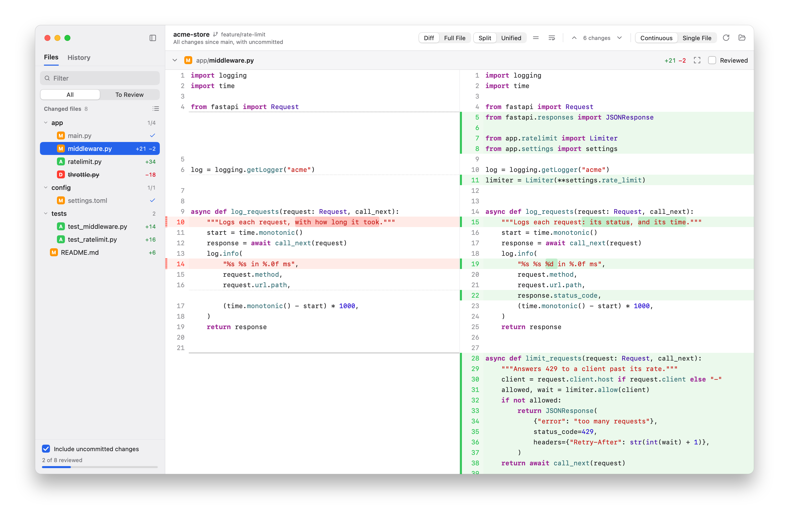

# Osprey

A desktop app for reviewing code changes file by file, made for when an AI writes the code and a person checks it. Native on macOS, Windows and Linux, built with [MyGo](https://github.com/egoist/mygo).



- Read every change in one scrolling feed, or one file at a time, side by side or unified.
- Mark files reviewed; a file that changes again comes back to review.
- Watch an agent as it writes: Osprey refreshes as files change.
- Review a branch as its pull request will show it, or one commit at a time.

Its author has used about 1% of Git's commands, and still searches how to undo a commit. Osprey is small and simple, and means to stay that way.

## Install

Download Osprey from the [releases](https://github.com/overcat/osprey/releases). The builds aren't signed yet, so macOS and Windows ask you once to allow them. Then click Install on its welcome page, or choose File → Install Command Line Tool…, in the ☰ menu on Windows and Linux, to get the `osprey` command, and `osp`, its short name.

Osprey needs Git, and macOS 13 or later on Apple silicon, Windows, or Linux with GTK 3. It is developed on macOS; on Windows and Linux it is newer, so please report what doesn't work.

## Use

```sh
osp                     # the changes not committed yet
osp main                # what this branch changed since main, uncommitted changes too
osp main --committed    # the same, commits only
osp src                 # only the changes in src
osp HEAD~3              # the last 3 commits, and what's not committed
osp a.go b.go           # two files, or two folders
```

`osp --help` tells the rest. As git difftool:

```sh
git config --global difftool.osprey.cmd 'osprey --wait "$LOCAL" "$REMOTE"'
git difftool -d --tool=osprey main
```

## Develop

```sh
go run .                # Osprey on this repository's changes
go test ./...
./scripts/install.sh    # on macOS: Osprey.app in /Applications, with osprey and osp on the PATH
```

## License

[MIT](LICENSE). Osprey includes the work of others, under their own licenses: see [THIRD_PARTY_NOTICES.md](THIRD_PARTY_NOTICES.md).
